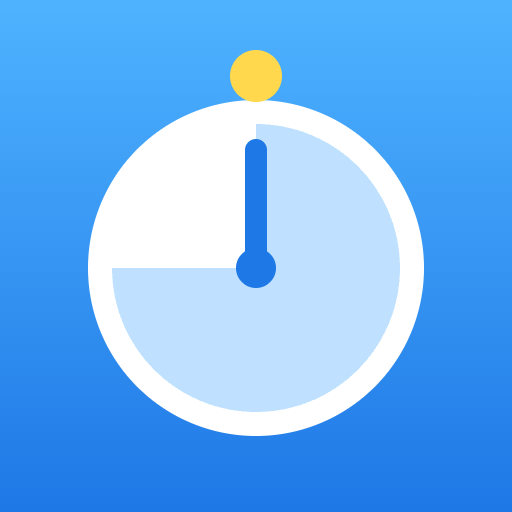

# AsaPace

Counts back from your leave time, so you know what to do now.

- ▶ **Try it:** https://manabitube0126-ship-it.github.io/my-idea-1010/
- 🎬 **Demo video:** https://manabitube0126-ship-it.github.io/my-idea-1010/demo.mp4
- 🎤 **Pitch video:** https://manabitube0126-ship-it.github.io/my-idea-1010/pitch.mp4
- 📄 **Pitch deck (PDF):** [pitch.pdf](pitch.pdf)

## About

### Hectic mornings are hard

Every morning, getting ready feels rushed. It is hard to know what to do next and how much time is left.

- Morning rush is a small problem we face every day
- We lose track of time while getting ready
- Idea: count back from the time you leave home
- AsaPace shows what to do right now

### How AsaPace works

Set your leave time and your tasks. Press Start, and AsaPace guides you step by step.

- Big countdown shows the time until you leave
- Task list: get dressed, breakfast, teeth, bag, shoes
- Press Done! to move on, or Skip a task
- A comment and face show if you are ahead or behind

### A calmer morning

A small tool can make each morning a little easier. You can see your pace and change your plan.

- Add, delete, or change tasks and minutes
- Your settings are saved on your device
- Fast demo mode and English/Japanese switch
- Next: more ideas to make mornings even easier

## How it was made

Built by shaping the idea together with AI (Claude) and publishing the AI-written code.
The full conversation is in [IDEA.md](IDEA.md) (Japanese).

## Files

- `index.html` — the app (a single self-contained file)
- `IDEA.md` — the idea log
- `pitch.pdf` — the pitch deck
- `assets/logo.png` — the logo
